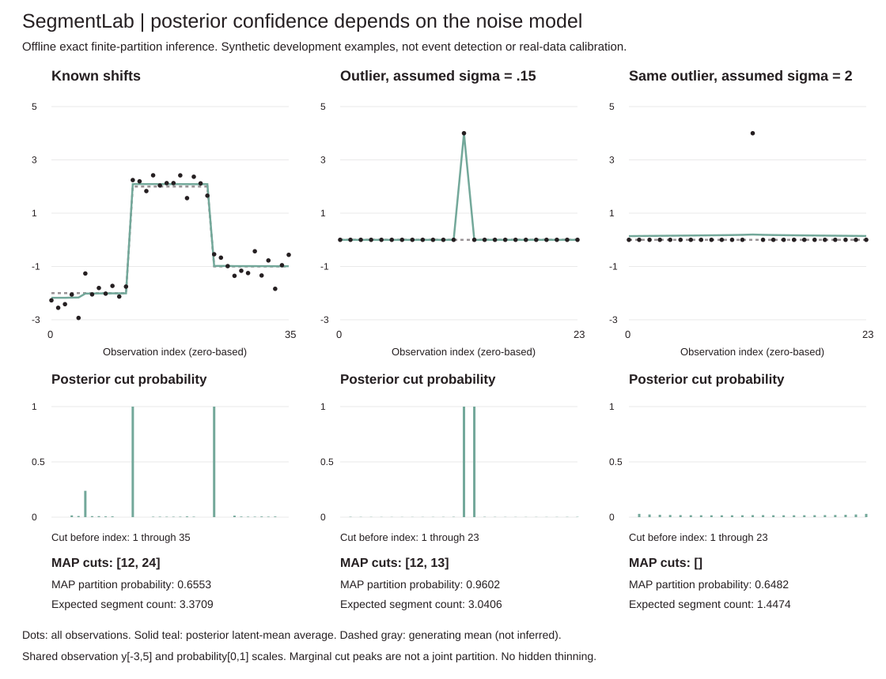

# SegmentLab

**A posterior can be confident about a cut that is only an outlier.** Exact offline Bayesian inference over finite Gaussian changepoint partitions, with constrained-prior normalization, forward/backward sums, segment-count and boundary marginals, a complete MAP partition and posterior segment-mean uncertainty. Every interval's probability and conjugate evidence is retained. Direct joint posterior draws are optional; exact marginals require no sampling. No external dependencies.



## Run offline

```sh
python -m unittest discover -s tests -v
python -m segmentlab demo > /tmp/segment-demo.json
python examples/render_demo.py /tmp/segment-demo.json --check
python -m segmentlab infer examples/sequence.json
python -m segmentlab sample examples/sequence.json --draws 4 --seed 23
```

Python3.10+, standard library only. No model/data downloads, accounts, GPU or paid API. CLI `infer` requires exactly the fields in `examples/sequence.json`; API `infer(data, noise_std=.5, prior_mean=0, prior_std=3, cut_probability=.08, min_length=2, max_segments=8)` also has defaults. Data are a single ordered scalar sequence. All results are offline: later observations inform earlier cuts and means. Do not present them as streaming alerts or forecasts.

## Explicit model and prior

Observations within a segment are conditionally independent `y_i~Normal(mu_segment,sigma²)`, with **known, supplied** noise sigma. Each segment independently draws `mu_segment~Normal(m0,tau²)`. Noise scale, mean prior, cut probability and constraints are supplied settings, not learned here. There are no slopes, changing noise, correlated errors or robust outlier components.

On the N-1 interior gaps, independent Bernoulli cut probability p gives an unconstrained partition with K segments weight `p^(K-1)*(1-p)^(N-K)`. SegmentLab **conditions this prior** on all segment lengths>=min_length and K<=max_segments. It computes the admissibility mass Z_prior and divides by it in the reported data evidence. This is not an unnormalized penalty score masquerading as marginal likelihood. The posterior over counts includes the number of admissible partitions at each K; it is not uniform in K.

For an interval of length l, empirical mean xbar and centered sum of squares M2, integrating its mean gives:

```text
log P(y_interval) = -l/2*log(2*pi*sigma²)
                    -1/2*log(1+l*tau²/sigma²)
                    -M2/(2*sigma²)
                    -l*(xbar-m0)²/(2*(sigma²+l*tau²))
v = 1/(1/tau² + l/sigma²)
m = m0 + l*tau²/(sigma²+l*tau²)*(xbar-m0)
```

Centered sums use online mean/M2 updates rather than subtracting two large raw sums. Forward `F[k,end]` log-sums all k-segment prefix likelihoods; backward `B[k,start]` does the same for suffixes. Combining a prefix, one interval and a suffix, with the appropriate whole-partition prior weight, gives each interval's posterior mass. Summing intervals ending at a gap gives that cut's marginal. A separate max-product recurrence/backtrace gives the complete MAP partition. Marginal peaks are not a joint partition and need not match its cuts.

Pointwise latent means average over all covering interval posteriors. Variance includes both within-interval mean uncertainty and between-partition mean uncertainty, using a centered mixture formula. It is **not future-observation variance** and excludes sigma²; no interval bands or coverage claims are supplied. The probability that each point is covered by one segment, expected segment count from interval masses, expected cuts from boundaries and count-probability total are exposed as audits.

## Measured development examples

A selected synthetic fixture uses seed19,36 observations, sigma.35 and true means −2/2/−1 for12 points each. Settings: m0=0,tau3,p.06,min_length3,max_segments6. It sums49,662 admissible partitions. MAP cuts are `[12,24]`, MAP partition probability.655305, expected segment count3.370941, with cut probabilities near1 at12 and24. A third marginal peak at5 has probability.238269: uncertainty is not hidden by showing only the MAP result. No untouched-test or best-parameter claim follows.

The counterexample uses the **same observed**24-point sequence for two fits: zeros except one value4 at index12. The generating mean is zero throughout; the impulse is a deterministic contamination, not a true mean segment. Both fits use m0=0,tau3,p.05,min_length1,max_segments6 and sum44,552 partitions:

| Supplied noise assumption | MAP cuts | MAP partition probability | Expected segments |
|---|---|---|---|
| sigma.15 | [12,13] | .960218 | 3.040626 |
| sigma2 | [] | .648223 | 1.447386 |

The low-noise model confidently isolates the outlier as its own segment. This demonstrates model dependence, not that the high-noise setting is generally correct or a causal diagnosis. Different sigmas define different likelihoods; no sampler, quality, speed or calibration ranking is claimed. Demo asserts both known-shift recovery and this failure direction. The full JSON includes all observations, model settings, intervals, probabilities and variances, not only these summaries.

## Validation and limits

14 initial tests cover independent sequential-predictive interval evidence, exhaustive partition enumeration at tiny sizes, evidence/prior normalization, interval/boundary/count marginals, complete MAP partition and probability, pointwise mixture variance, sum rules, impossible intervals, sign/translation invariance, large offsets, JSON/CLI and invalid inputs. CI uses Python3.10..3.13 and regenerates/byte-checks the SVG. The SVG shows all observations, posterior means and boundary probabilities with shared observation and probability axes; it has no inferred credible bands or hidden thinning.

Inputs:1..120 finite observations and prior mean in[-1e6,1e6]; noise/prior standard deviation in[1e-4,1e4]; p in[1e-6,1-1e-6]; integer min_length1..N and max_segments1..12. Effective cap is min(requested,floor(N/min_length)), returned explicitly. No approximation or posterior pruning is used; probability underflow can still occur for negligible partitions. If posterior normalization/coverage loses more than1e-8, inference fails instead of returning numerically unresolved probabilities. These are floating-point exact finite sums, not symbolic arithmetic or a formal error certificate.

The interval table uses rolling centered statistics in O(N²), and combines marginal interval prefixes/suffixes in O(N²*K²), with O(N²+N*K) storage. It does not claim the optimized complexity of a paper or a wall-clock advantage. Small bounded sequences are deliberate. No learned hyperparameters, online alert, multiple-testing control, event labels, causal explanation, real-data calibration or model-misspecification guarantee.

## Sources and attribution

Independent implementation inspired by the independent-segment/product-partition recursions in [Fearnhead, Exact and Efficient Bayesian Inference for Multiple Changepoint Problems, Sections2/3](https://people.csail.mit.edu/siracusa/papers/fearnhead06.pdf). This implementation uses the explicitly conditioned Bernoulli-gap prior above, a capped segment-count forward/backward recurrence and conjugate normal means with fixed known sigma. It does not copy reference code, reproduce the paper's data/simulations, implement its sampling/pruning algorithm or claim identical prior endpoint conventions. Gaussian integration and each recurrence are documented here for inspection. MIT licensed.

## Rolling interval statistics without posterior changes

The score table now extends a running mean/M2 accumulator once for each interval start, rather than slicing and rescanning every candidate interval. Each emitted interval uses exactly the same observation order and conjugate formula as the standalone independent scorer. This removes repeated accumulation while retaining every interval, without a prefix raw-square subtraction that would worsen large-offset cancellation.

`score_work` reports actual scalar observation-accumulation counts for building interval scores, plus the count required to independently rescan those same intervals:

| Interval construction fixture | Intervals scored | Rolling updates | Independent rescans | Avoided updates |
|---|---|---|---|---|
| N36,min_length3 (shift demo) | 595 | 663 | 8,330 | 7,667 |
| N24,min_length1 (outlier demo) | 300 | 300 | 2,600 | 2,300 |
| N120,min_length1 (maximum N) | 7,260 | 7,260 | 295,240 | 287,980 |

These are mean/M2 observation updates, **not total arithmetic, allocations or wall-clock timings**. Short prefixes needed to reach minimum length are counted even though they are not emitted. The count formula is independently checked against instrumented observation reads. Interval score construction is now O(N²); the unchanged marginal prefix/suffix combinations still cost O(N²*K²), so no claim that the entire inference became linear or that a measured speedup follows.

Seven new tests compare every interval exactly with independent rescans over many lengths, constant/large-offset/extreme inputs, instrumented update counts, exhaustive count formulas, full posterior equality under an injected rescan table, maximum N, no aliases and the public work audit. **21 tests at this increment** (34 after joint sampling below). All prior demo fields are exactly unchanged after removing the newly added `score_work` field from each inference result. The SVG is byte-identical and CI still regenerates it. This is an implementation work reduction, not a new inference method, changed prior, posterior pruning or statistical-quality result.

## Joint posterior draws, not thresholded marginal cuts

```sh
python -m segmentlab sample examples/sequence.json --draws 4 --seed 23
python examples/sample_audit.py > /tmp/sample-audit.json
```

API `sample_posterior(data, draws=100, seed=0, **settings)` accepts the same model settings as `infer`, with integer draws1..10,000 and seed0..2**32-1. It returns the unchanged full inference, seed, draw count and every drawn partition, its integrated posterior log probability/probability, conditional segment-mean parameters, drawn segment means and complete latent-mean path. That partition probability integrates out means: it is **not a sampled continuous path density**. The latent path excludes future observation noise.

First draw K with log weights `F[K,N] + (K-1)*log(p) + (N-K)*log(1-p)`. Given K and current end e, draw the preceding start s with weights `exp(F[k-1,s] + log P(y[s:e]))`, then repeat with k-1 and end s. The whole-partition prior is constant conditional on K, so it cancels from these conditional start choices. Every path starts at0, ends atN, and respects minimum length and the count cap. Marginal cut probabilities are never thresholded or sampled as independent Bernoulli decisions. The product of count and conditional-start probabilities telescopes to the full partition posterior. Finally draw each segment mean independently from its conjugate Normal(m,v), holding it constant throughout that segment.

This is a direct backward sampler with independent pseudorandom draws, not MCMC. There is no burn-in, thinning, proposal acceptance, learned tuning or convergence diagnostic. It reconstructs a prefix table once from the already computed interval evidence in an additional O(N²*K) recurrence. Each draw scans at most O(K*N+N) work including path materialization; storing D complete paths costs O(D*(N+K)), in addition to inference storage. Full inference still has O(N²*K²) marginal work. No rescan or full inference occurs per draw. A local `random.Random(seed)` leaves global random state untouched. Reproducibility is for this implementation/runtime; no cross-language or future-version byte identity is promised.

### Fixed-seed finite-sample audit

The committed audit uses all10,000 draws, seed19, observations[-.7,-.4,.6,.9], sigma.5,m0=0,tau3,p.08,min_length1,max_segments4. All8 partitions are admissible:

| Segments | Exact posterior mass | Draw frequency |
|---|---|---|
| 1 | 0.625920396 | 0.6265 |
| 2 | 0.361011542 | 0.3615 |
| 3 | 0.012952635 | 0.0120 |
| 4 | 0.000115427 | 0.0000 |

Maximum absolute count-frequency error is 0.000952635; cut-frequency error 0.002322345; latent-mean error 0.002823531; latent-variance error 0.004703666. Variance uses divisor10,000; exact comparison values average over all partitions and conditional mean variance. Every point/count/cut comparison and the first three unselected draws are retained in JSON. These are fixed-seed development checks, not error bounds, untouched-test performance, credible-band coverage or real-data calibration. In particular, **zero draws of K4 does not mean its posterior mass is zero**: its positive mass is retained in the exact inference. Sampling cannot replace the exact rare-event probabilities.

13 new tests bring the total to **34**. For every admissible partition in several tiny fixtures, the product of backward conditional probabilities matches an independent exhaustive partition probability, including constrained/forced/single-observation cases. Additional checks cover every categorical bin midpoint, impossible/underflow weights, whole-path constraints and integrated mass, exact conditional Gaussian call parameters, fixed-seed moment/frequency regressions, input/alias/global-RNG isolation, validation, bounded maximum N, extreme values, CLI and the audit script. Gaussian moment regressions supplement, rather than replace, exhaustive discrete-law checks. Existing inference demo JSON remains exactly identical; its SVG remains byte-identical.

All finite sums and sampling weights use floating point; exponentiation may underflow for tiny choices, and a finite pseudorandom uniform cannot represent every real probability. Normal draws are numerical too. No symbolic exactness, arbitrary-tail sampling guarantee, real-data calibration or robustness to a wrong noise model follows. The sampler is independently derived from this implementation's capped prefix recurrence, not a reproduction of the cited paper's sampling algorithm.
