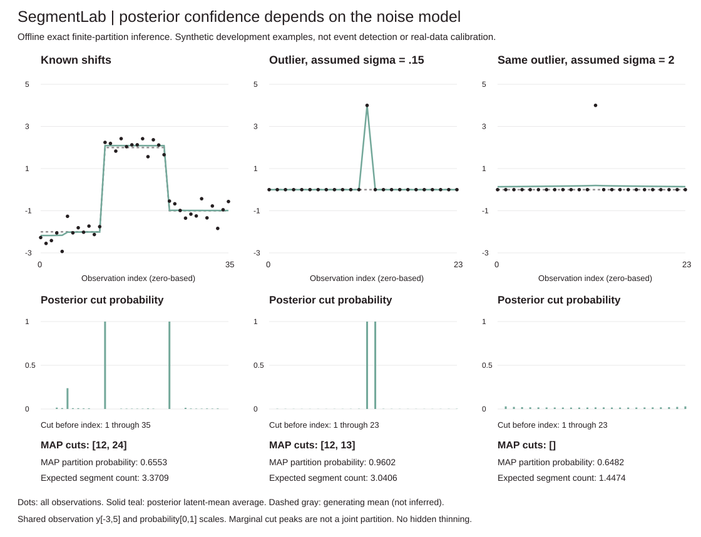
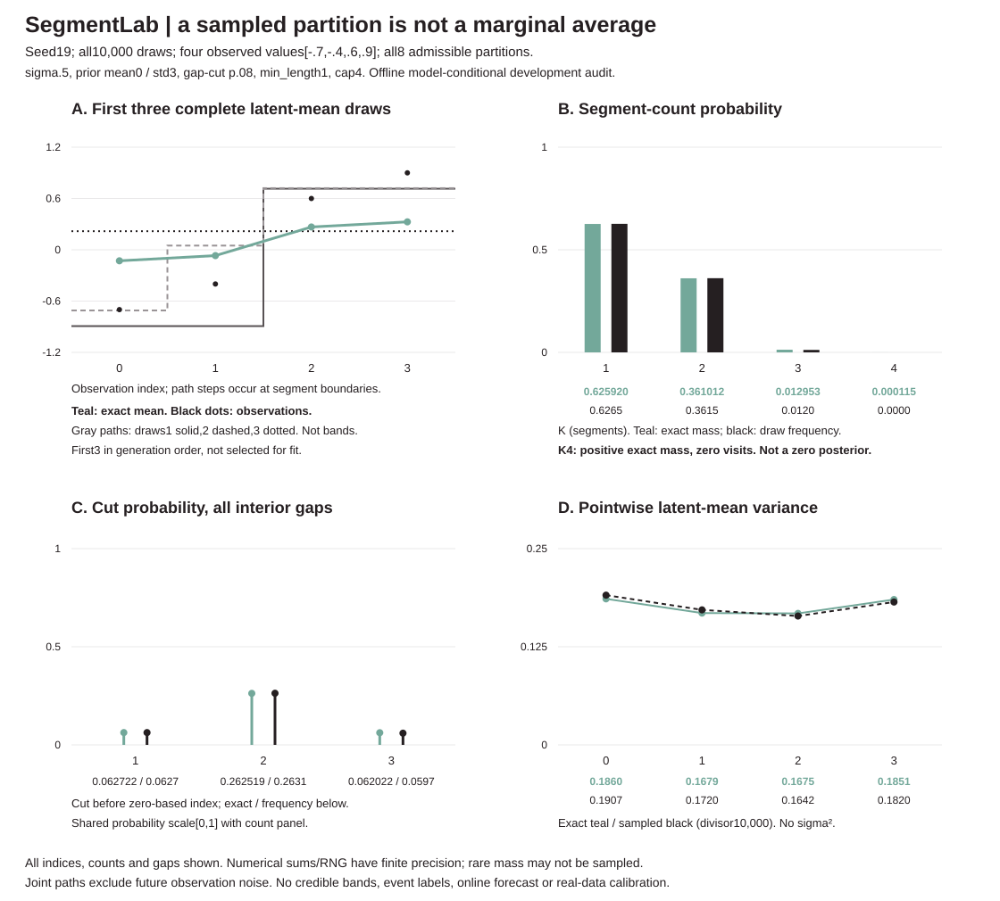

# SegmentLab

**Confident cuts can be wrong.** Exact offline Bayesian Gaussian changepoint inference, plus tools to inspect the whole partition law, draw complete partitions and make decisions under an explicit loss. Dependency-free Python3.10+, local data only, no paid API or GPU.

The same isolated outlier is assigned a high-probability two-cut segment under a low supplied noise scale. That is model confidence, not evidence that an event occurred.



## Run it

From the repository root:

```sh
python -m unittest discover -s tests -v
python -m segmentlab --help
python -m segmentlab infer examples/sequence.json
python -m segmentlab sample examples/sequence.json --draws 4 --seed 23
python -m segmentlab joint examples/sequence.json --pairs '[[1,3],[2,4]]'
python -m segmentlab information examples/sequence.json
python -m segmentlab decide examples/sequence.json --false-cut-cost 1 --missed-cut-cost 1
```

Every model command reads exactly these seven fields, with no extra keys:

```json
{"data":[-1.1,-0.9,-1.0,1.0,0.9,1.1],"noise_std":0.2,"prior_mean":0.0,"prior_std":3.0,"cut_probability":0.1,"min_length":2,"max_segments":3}
```

`demo` takes no file. Output is JSON; invalid inputs exit2 with an error on stderr. Python APIs accept model defaults, but the CLI intentionally requires a complete model payload. `python -m segmentlab COMMAND --help` describes each command's options, schema and bounds.

| Command / API | What it returns | What it does not mean |
|---|---|---|
| `infer` / `infer` | Conditioned-prior evidence; count, interval and boundary marginals; complete MAP; latent-mean moments | Marginal peaks are not a joint partition; latent variance excludes future observation noise |
| `sample` / `sample_posterior` | Seeded complete partitions and conditional Gaussian segment means | No MCMC or credible-band/calibration claim; zero visits do not imply zero mass |
| `joint` / `joint_cuts` | Joint inclusion and both conditional directions for requested cut pairs | Other cuts remain allowed; pairwise summaries do not determine the full law |
| `information` / `partition_information` | Full partition/count entropy, conditioned-prior KL, binary-cut entropy gap | Lower entropy or higher KL does not prove a correct model |
| `decide` / `boundary_decision` | Admissible minimum expected false/missed boundary loss; MAP/threshold comparisons | A supplied-loss optimum is not observed real-world accuracy |

All APIs are exported from `segmentlab`. For formulas, exact defaults and output semantics, see [the technical reference](DESIGN.md#explicit-model-and-prior). The reference preserves every fixture, implementation audit, bound and limitation.

## What is being inferred?

Each segment has an independent mean drawn from `Normal(prior_mean,prior_std²)`. Observations in that segment are conditionally independent `Normal(mean,noise_std²)` with **known supplied noise**. Independent Bernoulli interior-gap cut weights are **conditioned on minimum segment length and a segment-count cap**. The prior normalizer is computed and included in data evidence. Nothing here learns the noise, prior or cut probability.

All inference is offline: later observations inform earlier cuts and means. Intervals are half-open `[start,end)`; cut j means a boundary before zero-based observation j. No slopes, correlated errors or robust outlier component are included.

## Inspect the failure cases

- **Noise assumption:** the same24 observations (zeros except4 at index12) yield MAP cuts `[12,13]` with probability.960218 under sigma.15, versus no cuts with probability.648223 under sigma2. Both use the same mean prior and partition constraints. Different sigmas define different models, not a quality ranking.
- **Joint law:** two individually possible cuts can be jointly forbidden by a count cap. For six zeros and cap2, cuts2/4 each have mass.011658220257; their exact joint is0, while multiplying marginals invents mass.000135914100.
- **Decision objective:** a selected seven-point fixture has MAP `[3]`, but no cuts minimize equal-cost expected boundary loss (.680000591 versus MAP's.869071786). MAP instead minimizes whole-partition0/1 loss. These are posterior expectations, not measured mistakes.
- **Uncertainty:** the four-point fixture's posterior entropy1.029013408 exceeds prior entropy.836308115, yet KL is positive.166962288. KL is not prior entropy minus posterior entropy.

These are selected development examples, not held-out performance, event detection, causal attribution or real-data calibration. [The reference](DESIGN.md) states every input, setting, selection provenance and numerical qualification.

## Complete paths versus marginal averages



The first three generated latent paths are shown without selecting for fit. Count/cut frequencies and latent variances use **all10,000 draws**. All observations, counts, gaps and variance points are retained, with numeric SVG metadata. K4 has positive exact mass.000115427 but zero sampled visits. The figure is not a credible band. [Sampling method and finite-RNG limits](DESIGN.md#joint-posterior-draws-not-thresholded-marginal-cuts).

## Reproduce the audits

```sh
python -m segmentlab demo > /tmp/segment-demo.json
python examples/render_demo.py /tmp/segment-demo.json --check
python examples/sample_audit.py > /tmp/sample-audit.json
python examples/render_samples.py /tmp/sample-audit.json --check
python examples/joint_audit.py > /tmp/joint-audit.json
python examples/information_audit.py > /tmp/information-audit.json
python examples/decision_audit.py > /tmp/decision-audit.json
```

**90 tests.** Independent tiny exhaustive partition references check evidence, marginals, MAP, variance, sampler path probabilities, joint queries, entropy/KL and decision risk. Other tests cover sequential conjugate evidence, offsets/extremes, strict inputs, RNG/input isolation, work counts, CLI contracts and SVG geometry/regeneration. CI runs Python3.10..3.13 plus both figure checks. [Detailed validation and limits](DESIGN.md#validation-and-limits).

Inputs are bounded:1..120 observations and prior mean in[-1e6,1e6], noise/prior std in[1e-4,1e4], p in[1e-6,1-1e-6], integer minimum length1..N and requested cap1..12. Exact means finite-partition sums **in floating point**, not symbolic arithmetic: negligible mass can underflow, near ties can move and numerical guards are not formal certificates. Full marginal inference costs `O(N²*K²)`; feature-specific costs and output bounds are in the reference. No streaming alerts, forecasts, learned hyperparameters, credible-band coverage or model-misspecification guarantee.

## Read further

- [Model, prior and conjugate evidence](DESIGN.md#explicit-model-and-prior)
- [Rolling interval work audit](DESIGN.md#rolling-interval-statistics-without-posterior-changes)
- [Direct joint sampling](DESIGN.md#joint-posterior-draws-not-thresholded-marginal-cuts)
- [Exact joint cut queries](DESIGN.md#exact-joint-cut-inclusion-queries)
- [Full partition entropy and KL](DESIGN.md#full-partition-entropy-and-information-in-nats)
- [Constrained boundary-loss decisions](DESIGN.md#constrained-bayes-decisions-under-boundary-loss)

Independent implementation inspired by [Fearnhead, Exact and Efficient Bayesian Inference for Multiple Changepoint Problems](https://people.csail.mit.edu/siracusa/papers/fearnhead06.pdf). This uses its own explicitly conditioned prior and capped recurrences, not copied code, paper experiments, pruning or a reproduction of the paper's sampling algorithm. [Attribution details](DESIGN.md#sources-and-attribution). MIT licensed.
